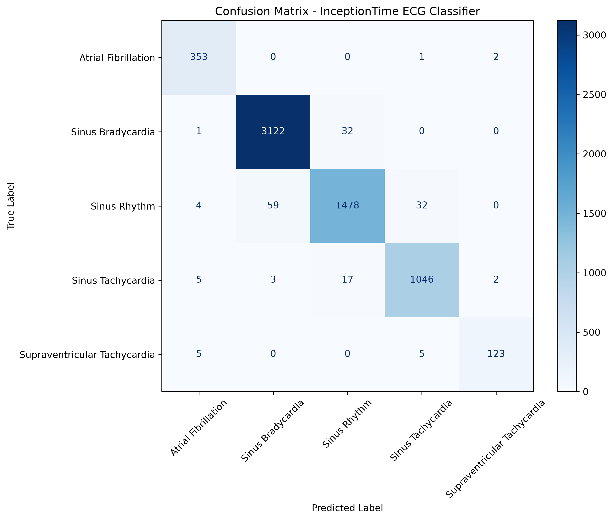
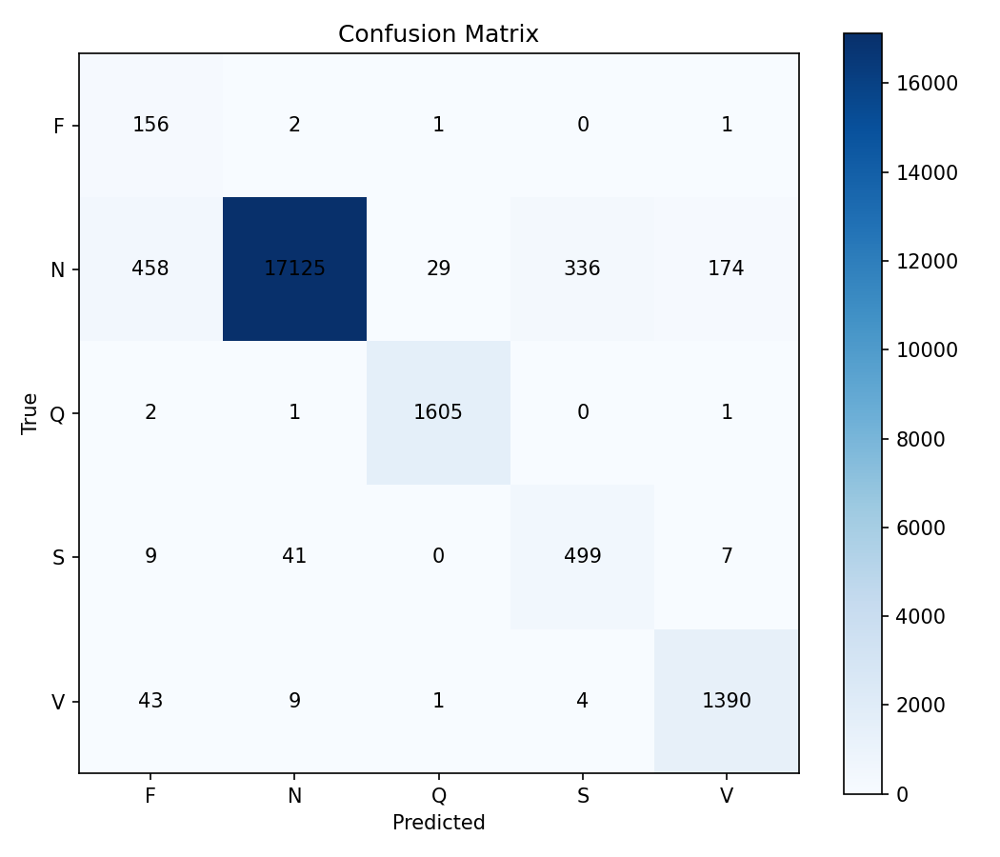
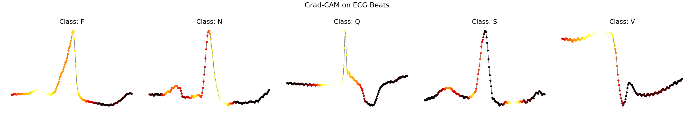
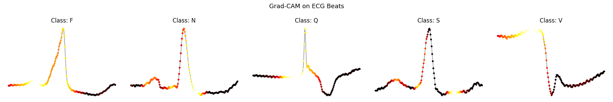
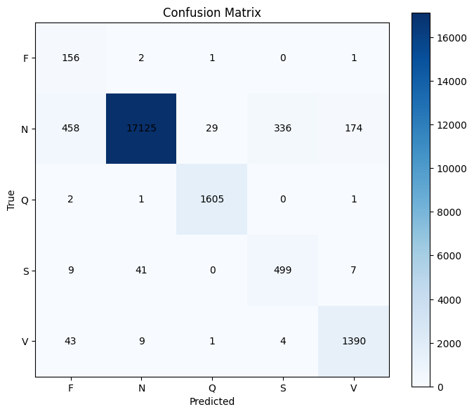

# 🫀 TrustECG – Explainable ECG Arrhythmia Classification

<div align="center">


**An Explainable AI-Based Approach to ECG Arrhythmia Classification**

</div>

---

## 📌 Project Overview

**TrustECG** is a deep learning-based ECG arrhythmia classification project developed to explore automated cardiac rhythm analysis using Explainable Artificial Intelligence (XAI).

The project focuses on classifying ECG signals into different cardiac rhythm categories while incorporating explainability techniques to make model predictions more interpretable.

It combines deep learning-based classification with visual explanations, helping users understand which regions of an ECG signal contribute to a model's predictions.

The project aims to make AI-based ECG analysis more understandable and transparent.

## 🎯 Objectives

- Develop a deep learning-based approach for ECG arrhythmia classification.
- Preprocess ECG signals for model training and evaluation.
- Explore InceptionTime-based time-series classification.
- Apply Explainable AI techniques to interpret model predictions.
- Visualize relevant ECG signal regions using Grad-CAM.
- Integrate model functionality with an application interface.

## 🧠 Methodology

The project follows a structured workflow:

1. **Data Collection:** Work with ECG data from the Chapman ECG dataset.
2. **Preprocessing:** Prepare ECG signals for model input and handle data quality issues.
3. **Model Development:** Implement deep learning-based ECG classification using InceptionTime.
4. **Classification:** Generate predictions for ECG rhythm categories.
5. **Explainability:** Apply Grad-CAM to visualize signal regions influencing model predictions.
6. **Visualization:** Present classification outputs and explainability results.

## 🏗️ Model Architecture

### InceptionTime

InceptionTime is a deep learning architecture designed for time-series classification.

It uses multiple convolutional operations with different kernel sizes to capture patterns at different temporal scales.

In this project, InceptionTime is explored for learning relevant patterns from ECG signals.

### Explainable AI – Grad-CAM

Grad-CAM (Gradient-weighted Class Activation Mapping) is used to generate visual explanations of model predictions.

It helps identify regions of an ECG signal that contribute to the classification output, providing an interpretability layer alongside the model's predictions.

## 📊 Results & Visualizations

The repository includes visual outputs generated during model development and evaluation.

### Confusion Matrix

The confusion matrix provides a visual representation of classification performance across different classes.

<p align="center">
  
</p>

### Confusion Matrix with Values

<p align="center">
  
</p>

### Grad-CAM Explainability

Grad-CAM visualizations highlight signal regions relevant to the model's predictions.

<p align="center">
  
</p>

<p align="center">
  
</p>

### Model Output

<p align="center">
  
</p>

Additional visualizations are available in the `results/` directory.

## 👩‍💻 My Contributions

As a member of the project team, my primary responsibilities included:

- **UI/Frontend Development:** Contributed to developing the user interface for the ECG classification application.
- **Frontend–Backend Integration:** Worked on connecting frontend components with backend functionality.
- **Application Integration:** Contributed to presenting model outputs through the application interface.

The project also involved collaborative work on model development, classification, and explainability.

## 🛠️ Technologies Used

| Category | Technologies |
|---|---|
| Programming Language | Python |
| Deep Learning Framework | PyTorch |
| Model Architecture | InceptionTime |
| Explainable AI | Grad-CAM |
| Data Processing | NumPy, Pandas |
| Visualization | Matplotlib |
| Development Environment | Visual Studio Code |

ECG-Arrhythmia-Classification/
│
├── src/
│   ├── chapman_ecg.py
│   ├── preprocess_chapman.py
│   └── train_inception.py
│
├── notebooks/
│   ├── chapman_ecg.ipynb
│   └── ecg_model.ipynb
│
├── results/
│
├── presentation/
│   └── TrustECG_Project_Presentation.pptx
│
├── confusion_matrix.png
├── confusion_matrix_numbers.png
├── corrected_gradcam_result.png
├── gradcam_ecg.png
├── output_corrected.png
├── outputmatrix[]withvalue.png
│
├── .gitignore
└── README.md
```

## ⚙️ Getting Started

### Prerequisites

- Python 3.x
- Visual Studio Code
- PyTorch
- Required Python libraries used by the project scripts
- Access to the required ECG dataset

### Clone the Repository

```bash
git clone https://github.com/ananyadinne09-source/ECG-Arrhythmia-Classification.git
```

### Navigate to the Project Directory

```bash
cd ECG-Arrhythmia-Classification
```

### Install Dependencies

Install the Python packages required by the project scripts.

The exact dependency list should be determined from the import statements in the source files.

### Run the Project

Open the project folder in Visual Studio Code.

Run the preprocessing script:

```bash
python src/preprocess_chapman.py
```

Run the model training script:

```bash
python src/train_inception.py
```

**Note:** The required ECG dataset must be obtained and configured separately before running the preprocessing and training workflow.

## 📚 Project Presentation

For additional information about the project, refer to the presentation included in this repository:

[View Project Presentation](presentation/TrustECG_Project_Presentation.pptx)

## ⚠️ Disclaimer

This project is developed for academic and educational purposes. It is not intended to replace professional medical diagnosis, clinical evaluation, or medical advice.

## 👥 Acknowledgement

Developed as an academic project at **St Joseph Engineering College, Mangaluru**, with collaborative contributions from the project team.

---

<div align="center">

**🫀 Making ECG analysis more interpretable through Explainable AI.**

*Built with curiosity, collaboration and continuous learning.*

</div>
